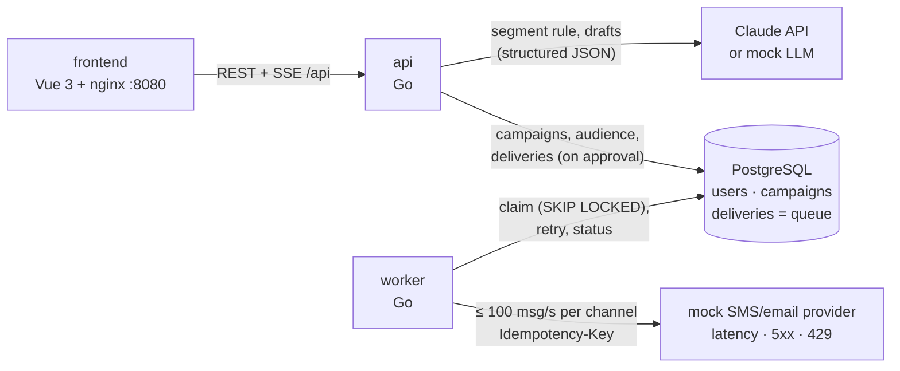

# Smart Campaign Composer

A marketer describes a campaign in plain language; Claude turns it into a target audience and
SMS/email drafts, a human reviews and approves, and the messages are sent through a queue to a
mock provider while a dashboard shows delivery live.

The reasoning behind every choice is in [`DECISIONS.md`](DECISIONS.md); the phases, their
verification evidence and the requirement IDs are in [`docs/PLAN.md`](docs/PLAN.md).

## Quick start

Requirements: Docker (with Compose) and `make`. No Go or Node installation is needed.

### Without an API key (mock LLM)

```bash
docker compose up
```

No `.env` file is needed. Without a key the api answers with the **mock LLM**: a catalog of scripted
answers (DECISIONS.md D12), shown as "Demo mode" in the UI. Pick a brief from the **Brief library**
for a deterministic run of the whole flow; other briefs get a rough keyword-based reading (see
[Known gaps](#known-gaps)).

### With Claude

```bash
cp .env.example .env    # then set ANTHROPIC_API_KEY=... in .env
docker compose up
```

With `LLM_PROVIDER=auto` (the default) the api uses Claude (`claude-sonnet-5-5`, D13) when the key is
set, so **every brief is a paid API call**. `LLM_PROVIDER=mock` forces the mock even with a key, and
`LLM_PROVIDER=anthropic` refuses to start without one. `GET /api/config` shows which one answers.

### Where things are

| What | URL |
|---|---|
| Web UI (and the API under `/api`) | http://localhost:8080 |
| API directly, health and metrics | http://localhost:8081 (`/healthz`, `/readyz`, `/metrics`) |
| Worker metrics (debug) | http://127.0.0.1:18091/metrics |
| Mock provider (debug) | http://127.0.0.1:18090/healthz |
| PostgreSQL | `127.0.0.1:55432` (user/password/db: `scc`) |

Every port is published on `127.0.0.1` only. The first start seeds 5,000 fake users (seed 42). Ports, the
seed size and the mock provider's fault rates can be changed in `.env` (see `.env.example`). The API contract
is in [`docs/API.md`](docs/API.md).

## How it works



1. **Audience.** Claude turns the brief into a segment rule in a small whitelisted JSON DSL, returned
   as structured output (D8, D9). The backend validates it (fields, operators, values) and compiles it
   to a parameterized query; model output is never executed as SQL. Criteria no field can express are
   returned as `unsupported_criteria` and shown as a warning, never guessed. The UI shows people and
   reachable recipients per channel: consent **and** contact data.
2. **Drafts.** SMS and email are written in parallel and streamed over SSE. Every answer is decoded
   strictly and checked against the content rules: SMS ≤ 160 and subject ≤ 80 characters with the
   longest names in this audience filled in, only `{{first_name}}`, `{{last_name}}`, `{{city}}`, no
   emoji. A failed check goes back to the model with the concrete errors, up to 3 attempts; after that
   the marketer edits by hand. Nothing is truncated silently (D10, D11, D15).
3. **Approval.** Edits go through the same validator. Approval freezes the audience at the campaign's
   `as_of` time and, in one transaction, renders one delivery per person and channel
   (`UNIQUE (campaign, user, channel)`). Approving twice changes nothing (D24).
4. **Sending.** The `deliveries` table is the queue (D3). The worker claims rows with leases, spaces
   each channel's calls at least 10 ms apart, so at most 100 per second (D4), and sends each with the
   delivery's UUID as `Idempotency-Key` (D5). Retries follow D6: backoff with jitter for 5xx and
   timeouts, `Retry-After` for 429, no retry for other 4xx.
5. **Live dashboard.** The api streams a full snapshot every second: progress per channel, the
   sends-per-second chart against the 100/s line, recent provider errors. After a dropped connection
   the UI reconnects and keeps the last numbers on screen (D7, D25, D26). Prometheus metrics come
   from the api and the worker (D18).

The mock LLM and the mock provider are part of the stack, so the whole flow runs offline. Tests never
call the API: they use the mock and real Claude responses recorded once (D12, D16).

## Tests

```bash
make test     # Go unit + integration tests (race detector, throwaway PostgreSQL), vue-tsc, Vitest
make smoke    # end-to-end through the API on the running stack (mock LLM only)
```

- `make test` runs everything in containers and needs no key. The Go integration tests get a fresh
  database each (D20).
- `make smoke` starts the stack with `LLM_PROVIDER=mock` (even when `.env` has a key) and runs five
  scenarios of [`docs/TEST-SCENARIOS.md`](docs/TEST-SCENARIOS.md) through the API: audiences, draft
  states with a repair, a manual edit, every content error code, the `409`/`422` answers at approval,
  a second approval and the live stream to the end. It refuses to run against Claude. It creates new
  campaigns in the stack's database, and its pinned audience numbers assume the default seed (5,000
  users, seed 42).
- [`docs/TEST-SCENARIOS.md`](docs/TEST-SCENARIOS.md) has 20 briefs a marketer would write, with the
  expected rule, audience and outcome, to try by hand in the UI or with `curl`.
- **CI:** GitHub Actions runs `make test` on every push to `main` and every pull request
  ([`.github/workflows/ci.yml`](.github/workflows/ci.yml)), with no secrets.

## Useful commands

| Command | What it does |
|---|---|
| `make up` / `make down` | Start / stop the stack |
| `make clean` | Stop and delete all data (volumes) |
| `make logs` | Follow logs of all services |
| `make reseed` | Delete all users **and campaigns**, then seed again |
| `make psql` | Open a SQL shell |

## Security notes

There is no login (a single marketer, A10), so the stack is meant for your own machine:

- every port is bound to `127.0.0.1`, so other hosts on the network cannot reach the UI or the API;
- the API refuses requests that another web page could send through your browser: a foreign `Host`
  (DNS rebinding), a cross-site `Sec-Fetch-Site`, a foreign `Origin`, or a non-JSON body
  ([`docs/API.md`](docs/API.md) → Conventions). If you open the UI under another host name, add it to
  `HTTP_ALLOWED_HOSTS`;
- nginx sends a strict Content-Security-Policy and refuses to be framed;
- with a key in `.env`, every brief is a paid Claude call; use `LLM_PROVIDER=mock` when you only try the flow.

The security audit, its findings (what is fixed and what is still open, for example a way to stop a
sending campaign) and the release checklist are in [`docs/security-threat-model.md`](docs/security-threat-model.md),
[`docs/security-risk-register.md`](docs/security-risk-register.md) and
[`docs/security-release-checklist.md`](docs/security-release-checklist.md).

## Known gaps

Not built, by choice or for time (the reasons are in DECISIONS.md):

- **Bonus items:** scheduled sending, A/B variants and per-user language were not built (CI was:
  see [Tests](#tests)).
- **Scope:**
  - authentication and multi-tenancy (a single marketer, A10; see [Security notes](#security-notes));
  - delivery-receipt webhooks: the status is the provider's synchronous answer (A8);
  - quiet hours and frequency capping.
- **Sending:**
  - pausing or cancelling a campaign that is sending (A12);
  - consent is not re-checked between approval and send, because the audience is frozen at approval;
  - the rate limiter lives in a single worker process, so several replicas would need a shared
    limiter (D4);
  - the mock provider forgets idempotency keys when it restarts.
- **Content:**
  - GSM-7/UCS-2 segment billing: 160 means 160 Unicode characters (A1);
  - field-to-field segment conditions.
- **Mock LLM:** briefs outside its catalog get a rough keyword reading. It never reports unsupported
  criteria, so a brief with only gender or age targets everyone without a warning, and some negations
  are read as the positive (D12). The Brief library and the test scenarios' briefs are in the catalog.
- **Frontend:**
  - light theme only;
  - layouts for 1024 px and wider (no mobile);
  - no browser end-to-end tests in `make test` (the flow was checked by hand, PLAN.md → P6).
- **Observability:** no Prometheus server or dashboards; the `/metrics` endpoints are ready to scrape.
- **Real-model checks:** three of the test scenarios were run on Claude (same rules as the mock). Six
  judgement-call briefs were not (TEST-SCENARIOS.md → Real-model check).

## Repository layout

```
backend/      Go module: cmd/{api,worker,mockprovider,migrate,seed,smoke}, internal/…, migrations/
frontend/     Vue 3 + Vite + TypeScript, served by nginx
docs/         CASE.md (the brief), PLAN.md (phases and evidence), API.md (contract),
              TEST-SCENARIOS.md (end-to-end scenarios), security-*.md (audit, risks, checklist)
DECISIONS.md  Decisions, assumptions and what is out of scope
.github/      CI workflow (make test)
DESIGN.md     Visual reference for the UI
ai-sessions/  Exported Claude Code sessions, with an index
```
