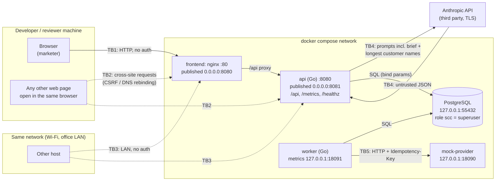

# Security Threat Model — Smart Campaign Composer

| | |
|---|---|
| **Audit date** | 2026-10-26 |
| **Code under review** | branch `feat/ci`, commit `68bffe4` (`main` + one CI commit) |
| **Reference framework** | *AI Ajanı Güvenlik Denetimi ve Güvenli Sistem Kurulum Başlıkları* (control catalogue, sections 3–11), mapped to OWASP Top 10 for Agentic Applications 2026 |
| **Companion documents** | [`security-risk-register.md`](security-risk-register.md) (findings, ranked) · [`security-release-checklist.md`](security-release-checklist.md) (go/no-go) |
| **Status** | Describes the system as audited (`68bffe4`); every `file:line` points to that commit. P9 (branch `fix/security-quick-wins`, `DECISIONS.md` D28) has since closed T1–T4 except authentication; see the risk register, §5 |

## 1. Method

1. **Code and configuration review** of every backend package (`backend/cmd/*`, `backend/internal/*`,
   `backend/migrations/*`), the frontend's API client, streams and approval UI, `nginx.conf`, both
   Dockerfiles, `docker-compose.yml`, `.env.example`, `.gitignore`, the CI workflow, `DECISIONS.md`,
   `README.md` and `docs/PLAN.md`.
2. **Test evidence**: the existing Go and Vitest suites were read to see which security properties are
   already asserted. The suites were **not re-run** for this audit; the latest CI run on `feat/ci`
   (2026-10-25 23:22 UTC) is green.
3. **Harmless live probes** against the running local stack (LLM mode `mock`, confirmed with
   `GET /api/config` first): port bindings (`docker compose ps`), response headers (`curl -I`), Host and
   Origin handling and Content-Type handling on the read-only `POST /api/segments/preview`, the
   database role's privileges, the metric names, and whether the production bundle contains Vue
   devtools. No campaign was created, edited or approved, and no LLM call was made.
4. **Secret and personal-data scan** of tracked files and of the full git history, counting matches only
   (values were never printed).

Every claim below carries a `file:line`, configuration, test or probe reference. Claims that could not
be checked are listed in [§11](#11-unverified-items).

## 2. System summary

A marketer types a campaign brief in natural language. The api asks an LLM (Claude Sonnet 5.5, or a
local mock when no key is configured) for (a) an audience rule in a small whitelisted JSON DSL plus a
campaign name and (b) one SMS and/or one email draft. The backend validates every answer
deterministically, a human reviews and approves, and a worker sends one message per person and
channel to an SMS/email provider (a mock in this repository) at ≤ 100 messages/s per channel. A live
dashboard streams delivery progress.

**Users:** one marketer, no accounts, no tenants (assumption A10, `DECISIONS.md:644`).

### 2.1 Autonomy profile (reference §5.1)

The LLM is **not an agent with tools**. It is a constrained text generator inside a deterministic
pipeline:

| Step | Who decides | Side effect | Evidence |
|---|---|---|---|
| Brief → audience rule | LLM proposes; validator accepts or rejects; never SQL | DB insert of a draft campaign | `internal/llm/generate.go:126-171`, `internal/segment/validate.go:50-56`, `internal/segment/compile.go:16-39` |
| Rule → drafts | LLM proposes; content validator accepts or rejects (≤ 3 attempts) | DB upsert of the draft message | `internal/llm/generate.go:15-17`, `internal/content/validate.go:92-134` |
| Edit | Marketer; same validator | DB upsert | `internal/campaign/service.go:345-374` |
| Approve | **Marketer only** (exact-action modal) | Freezes audience, inserts deliveries | `frontend/src/components/campaign/ConfirmSendModal.vue:36-84`, `internal/campaign/repository.go:292-348` |
| Send | Deterministic worker | Provider calls (external messages) | `internal/delivery/worker.go:37-170` |

Autonomy level: **"draft-only, human approval required before any external side effect"**. The model
has no tool calls, no memory between requests (every attempt is a fresh single-turn request,
`internal/llm/prompts.go:41-46`), no browsing, no code execution and no access to the database. This
low agency is the system's strongest security property; most residual risk sits in the classic web
layer around it (authentication, CSRF, headers) rather than in the LLM.

## 3. Architecture and trust boundaries

| Boundary | From → to | Trust of the input | Controls today | Gaps |
|---|---|---|---|---|
| **TB1** | Browser → nginx/api | Treated as trusted (single marketer) | Body limits 64 KiB (`internal/httpapi/campaigns.go:21,36`, `segments.go:15,52`); brief ≤ 2,000 runes (`internal/campaign/service.go:21`); strict JSON (`campaigns.go:46-48`) | No authentication or authorisation (`internal/httpapi/router.go:109-142`) → R-01 |
| **TB2** | Other web origins → api | Untrusted | No CORS headers are sent, so cross-origin reads are blocked | No Origin, Host or Content-Type check; state-changing GET; sequential ids → R-02; no anti-framing headers → R-08. **P9:** request guard and nginx headers added |
| **TB3** | LAN → published ports | Untrusted | Postgres, worker and mock provider are bound to `127.0.0.1` (`docker-compose.yml:35,103,134`) | UI and api bound to all interfaces (`docker-compose.yml:79,154`; probe: `0.0.0.0:8080`, `0.0.0.0:8081`) → R-01. **P9:** bound to `127.0.0.1` |
| **TB4** | api ↔ Anthropic | Model output is untrusted | Structured Outputs + strict decoding + business validation + bounded repairs (§6) | Customer names are sent to the provider → R-04; no spend ceiling → R-03 |
| **TB5** | worker → provider | Internal | Timeout, retry policy, idempotency key, rate spacer | Plain HTTP and no provider auth (acceptable for the mock only) |

## 4. Asset inventory (reference §3.1)

| Asset | Where | Sensitivity | Notes |
|---|---|---|---|
| `ANTHROPIC_API_KEY` | `.env` (git-ignored, mode 600 on the dev machine), api container env | **Secret** | Never in prompts, code, logs or responses (§9). Long-lived, no rotation process |
| Postgres credentials | `docker-compose.yml:17,30-31` (`scc`/`scc`) | Low (local demo) | Static, shared by all services; role is superuser (probe) → R-07 |
| Customer profiles (`users`) | Postgres; `migrations/0001_create_users.sql:5-37` | **Personal data** (name, email, phone, city, purchase behaviour, consent) | Seed data is fake (5,000 generated users). Treat as real for production |
| Rendered messages + recipient addresses (`deliveries`) | `migrations/0003_create_deliveries.sql:13-53` | Personal data | Kept indefinitely; no retention job → R-06 |
| Campaign briefs, rules, drafts | `migrations/0002_create_campaigns.sql` | Business-confidential | Briefs are sent to the LLM provider |
| System prompts, schemas, DSL registry | `internal/llm/prompts.go`, `schemas.go`, `internal/segment/registry.go` | Integrity-critical | Golden files make every prompt change visible in review (`internal/llm/llm_test.go:290`) |
| Mock LLM scenario catalog | `internal/llm/mock/scenarios/*.json` (embedded) | Integrity (tests) | |
| Model / provider | `claude-sonnet-5-5` via `anthropic-sdk-go v1.82.0` (`backend/go.mod`) | Third-party processor | Data-use and retention terms not verifiable from the repo (§11) |
| Container images, Go and npm dependencies | Dockerfiles, `go.sum`, `package-lock.json` | Supply chain | Pinned by tag, not digest → R-10 |
| CI pipeline | `.github/workflows/ci.yml` | Supply chain | `permissions: contents: read` (good); action pinned by tag; no branch protection → R-10 |
| Session exports | `ai-sessions/*.md` | May contain personal data | Scrub rule exists; scan in this audit found only documentation mentions, no leaked IPs or e-mails (§9) |

## 5. Data inventory and flows (reference §5.10)

| Data class | Collected from | Stored | Sent to | Shown to |
|---|---|---|---|---|
| Brief (free text, may contain anything the marketer types) | Composer | `campaigns.brief` | Anthropic (every attempt) | UI |
| Audience rule (DSL JSON) | LLM | `campaigns.segment_rule` | — | UI |
| **Longest first name, last name, city of the audience** (one real value per variable and channel) | `users` via `segment.Counter.LongestValues` (`internal/segment/audience.go:141-162`) | No (recomputed) | **Anthropic**, inside the content prompt (`internal/llm/prompts.go:154-158`, golden file `internal/llm/testdata/prompts/email_user.txt`) and inside repair messages (`internal/content/validate.go:136-151`) | **API response** `audience.longest_values` and every message report (`internal/campaign/service.go:408-417`, `internal/content/validate.go:69-70`) |
| Phone / email / names / city of each recipient | `users` at approval | `deliveries` (`0003:21-24`) | Provider (worker) | Not exposed by the API (dashboard issues carry no recipient, `internal/tracking/tracking.go:75-93`) |
| Aggregate counts | Postgres | — | — | UI, `/metrics` |
| Token usage | Anthropic response | Logs only (`internal/campaign/service.go:107-108,247-248`) | — | Operator |

Not sent to the LLM: email addresses, phone numbers, purchase data or any identifier
(`DECISIONS.md` D9: names, email and phone are not targetable; consent is applied by the backend,
`internal/segment/audience.go:52-60`).

## 6. LLM usage profile (reference §5.3, §5.11, §5.12)

| Property | Value | Evidence |
|---|---|---|
| Provider / model | Anthropic API, `claude-sonnet-5-5` (overridable by `LLM_MODEL`) | `internal/config/config.go:66-67,84` |
| Mode selection | `auto` → Claude if a key is set, otherwise mock; `anthropic` without key refuses to start | `internal/config/config.go:89-104`, test `config_test.go:129` |
| SDK hardening | `option.WithoutEnvironmentDefaults()`, explicit key/timeout/retries | `internal/llm/anthropic/client.go:73-79` |
| Output control | Structured Outputs JSON schema (closed objects) → strict decode (unknown keys, trailing data rejected) → business validation | `internal/llm/schemas.go:14-61`, `internal/llm/parse.go:134-146`, `internal/segment/validate.go`, `internal/content/validate.go` |
| Stop reasons | `refusal` and `max_tokens` handled before parsing | `internal/llm/anthropic/client.go:170-182`, test `llm/anthropic/client_test.go:149` |
| Attempt budget | 3 attempts per task, a second refusal is final; each attempt ≤ 60 s; SDK retries ≤ 2 per attempt | `internal/llm/generate.go:15-17,85-101`, `internal/config/config.go:86-87` |
| Max tokens | 8,000 (segment, email), 4,000 (SMS), thinking included | `internal/llm/anthropic/client.go:55-59` |
| Tools / function calling | **None** | `llm/anthropic/client.go:133-151` (no `Tools` param) |
| Memory / RAG | **None**; single-turn per attempt | `internal/llm/prompts.go:41-46` |
| Untrusted input in prompts | Brief (marketer), previous rejected answer (model), longest customer names (customer-controlled in a real CDP) | `prompts.go:93-100,144-174` |
| Prompt-injection posture | Brief wrapped in `<brief>` tags "as data"; not escaped. Impact bounded by output validation and human approval | `prompts.go:13-16,95-97` |
| Output sinks | DB → Vue text interpolation (auto-escaped, no `v-html`; grep) · email HTML via `html/template` · SQL only through the compiler | `frontend/src/components/campaign/MessageText.vue:14-22`, `internal/content/email.go:8-39` (test `content_test.go:261`) |

## 7. Threat actors (reference §3.2)

| Actor | Relevant here? | Capability |
|---|---|---|
| Malicious web page visited by the marketer | **Yes** | Sends cross-site requests to `localhost:8080/8081`; DNS rebinding |
| Other host on the same network | **Yes** | Direct HTTP to `0.0.0.0:8080/8081` |
| Customer with a crafted profile (name/city) | Yes, in production | Text reaches the prompt and the UI (indirect injection) |
| Careless or malicious marketer | Yes | Brief injection, mass send, cost burn — no second approver |
| Compromised dependency / image / action | Yes | Build-time or run-time code execution |
| LLM provider (outage, behaviour drift, data handling) | Yes | Wrong rule, refusal, data retention |
| Hallucinating model (no attacker) | Yes | Wrong audience or invented claims/links |
| Malicious MCP server / other agent | No | No MCP, no multi-agent |

## 8. Threat scenarios

Ranked by the corresponding risk (details and fixes in the risk register).

| ID | Scenario (attack chain) | Existing controls | Gap → finding |
|---|---|---|---|
| **T1** | **Cross-site mass send.** Marketer visits a malicious page → page sends `POST /api/campaigns` with `Content-Type: text/plain` (a CORS "simple request", no preflight) → loads `GET /api/campaigns/{n}/draft/stream` for the next sequential ids (an `EventSource` or `` is enough; the server generates and stores the drafts even if the response is unreadable) → `POST /api/campaigns/{n}/approve` (no body needed) → the whole audience receives the attacker's campaign without the confirm dialog ever being shown. | Approval requires `ready` state and re-validates content (`service.go:307-335`); idempotent approval | No Origin/Host/Content-Type check (`campaigns.go:35-53`; probe: `text/plain` + foreign `Origin` → 200), approve without body (`campaigns.go:135-146`), sequential ids (`0002:6`), state-changing GET (`campaigns.go:151-173`) → **R-02** · *closed in P9* |
| **T2** | **LAN access.** Another host on the café/office network opens `http://<laptop-ip>:8080`, reads campaigns and audience data (including customer names in reports) and approves sends; or scripts campaign creation to burn LLM credit. | None | `docker-compose.yml:79,154`, `router.go:109-142` → **R-01** · *network path closed in P9; no authentication yet* |
| **T3** | **DNS rebinding.** A page rebinds its domain to `127.0.0.1` and reads `/api/campaigns` as same-origin. | — | Foreign `Host` accepted (probe: `Host: attacker.example` → 200) → **R-02** · *closed in P9* |
| **T4** | **Clickjacking the approval.** The UI is framed invisibly and the marketer is tricked into clicking "Send messages". | Two-step confirm modal | No `frame-ancestors`/`X-Frame-Options` (probe headers; `frontend/nginx.conf`) → **R-08** · *closed in P9* |
| **T5** | **Denial of wallet.** Repeated `POST /api/campaigns` and draft streams. Worst case per campaign: 3 attempts × 3 HTTP tries × 3 tasks = 27 model calls of up to 8,000 tokens. | Per-attempt timeout, attempt budget, per-campaign in-process stream lock (`service.go:258-275`) | No rate limit, global concurrency cap or spend ceiling; no token metric → **R-03** |
| **T6** | **Personal data to a third party.** Real customers' longest names go to the LLM provider on every draft and repair. | Only three fields, never contact data | `prompts.go:154-158`, `content/validate.go:136-151` → **R-04** |
| **T7** | **Indirect prompt injection through customer data.** A customer registers with a long first name containing instructions; being the longest, it is quoted into the prompt. | `%q` quoting; schema-constrained output; validator; human approval | Not modelled or tested → **R-09** |
| **T8** | **Brief injection / hallucinated content.** Brief closes `</brief>` or asks for a phishing link; or the model invents a link/claim. | Strict schema, variable whitelist, emoji/length checks, marketer review | No link policy in `content.Validate`; no adversarial eval set → **R-09** |
| **T9** | **Wrong or uncontrollable send.** A bad campaign is approved and cannot be stopped except by killing the worker. | Confirm modal; idempotency | No pause/cancel/kill switch (A12, `README.md:143-148`) → **R-05** |
| **T10** | **Approved content differs from reviewed content** (second tab, CSRF `PUT`). | Row lock, revalidation at approval | Approve is not bound to a content version → **R-11** |
| **T11** | **Blast radius after api compromise.** Any RCE/SQLi in the api gives Postgres superuser (incl. `COPY … PROGRAM`). | Compiler never concatenates input (`compile.go:23-24`); fuzzed SQL shape (`compile_test.go:150`) | Shared superuser role, no `statement_timeout` (probe: `rolsuper = t`, `statement_timeout = 0`) → **R-07** |
| **T12** | **Supply-chain compromise** through an unpinned image/action or a vulnerable module. | Lockfiles, `npm ci`, CI read-only token | No SCA/secret scan in CI, tag pins, no branch protection → **R-10** |
| **T13** | **SQL injection through the DSL.** | Type-enforced `Validated` → `Compile` with bind params; injection and random-rule tests; differential oracle | None found (§9) |
| **T14** | **XSS through model output.** | Vue escaping, no `v-html`, `html/template` for email | None found (§9) |

## 9. Security strengths (verified)

| Control | Evidence |
|---|---|
| LLM output never becomes SQL: `Validated` has unexported fields and is the only input `Compile` accepts; every value is a bind parameter | `internal/segment/validate.go:50-56`, `compile.go:16-39`; tests `segment/validate_test.go:114` (8 injection payloads), `rule_test.go:53` (`"sql"` key rejected), `compile_test.go:150` (random rules, SQL token whitelist), `audience_test.go:44-64` (differential oracle) |
| Strict, layered output validation; nothing silently truncated | `parse.go:134-146`; `generate_test.go:267` (`TestNeverSilentlyTruncates`), `:105` (fault scenarios) |
| Consent applied by the backend, never by the model | `internal/segment/audience.go:52-60`; prompt tells the model not to touch consent (`prompts.go:60`) |
| Exact-action human approval: audience, per-channel counts, excluded people, full content, "can't be undone" | `ConfirmSendModal.vue:36-84` |
| Approval re-validates content against exactly the frozen recipients; idempotent; one transaction | `service.go:307-335`, `repository.go:292-348`, `0003:41` (`UNIQUE (campaign_id, user_id, channel)`); tests `approve_test.go:44,107,146,202` |
| Exactly-once effect towards the provider | UUID `Idempotency-Key` (`delivery/client.go:65`, `0003:17`); tests `handler_test.go` (`TestRepeatedKeyGetsTheOriginalAnswer`) |
| Output encoding | `email.go:8-39` + `content_test.go:261` (`<script>` escaped); Vue text interpolation; production bundle has no devtools (probe: 0 asset files match) |
| Secrets hygiene | `.gitignore:1-4`; `WithoutEnvironmentDefaults` (`llm/anthropic/client.go:74`); DB URL never echoed (`db.go:26-27`); gitleaks over all commits (`docs/PLAN.md:804`); this audit: 0 key-pattern matches in HEAD and history, `.env` never committed, `.env.example` key empty |
| Error hygiene: internal errors are generic to the client | `router.go:147-152`; tests `router_test.go:133`, `segments_test.go:115` |
| Input bounds | 64 KiB bodies, brief ≤ 2,000 runes, `ReadHeaderTimeout` 5 s (`cmd/api/main.go:132`), provider response read ≤ 64 KiB (`delivery/client.go:79`) |
| Resilience | Retry with full jitter and separate 429 budget (`retry.go:43-105`), lease ≥ 2× timeout (`config.go:160-164`), 100 msg/s spacer (tests `limiter_test.go`, `worker_test.go`) |
| Logs carry no message content or recipients | `worker.go:148-168`, request log has path only (`router.go:156-175`) |
| Least exposure of internal services | Postgres, worker metrics, mock provider on `127.0.0.1` |
| Non-root backend container | `backend/Dockerfile:26-28` (uid 10001) |
| Safe defaults for reviewers | No key → mock; `make smoke` forces mock and refuses Claude (`Makefile:44-46`) |

## 10. Control applicability (reference §5 and §7)

Legend: **A** applicable · **P** partly applicable · **N/A** not applicable. Priority as in the reference
(P0/P1/P2/conditional).

| § | Control area | Applies | Why | Status / finding |
|---|---|---|---|---|
| 4 | IBM core topics (eval-first, ADLC, attack surface, excessive agency, leakage, injection, sandbox, IAM, gateway/DLP, oversight, monitoring, drift, compliance) | P | Covered through the rows below | — |
| 5.1 | Governance, purpose, autonomy (P0) | A | Purpose, users, autonomy and out-of-scope actions are written down (`README.md`, `DECISIONS.md` A10–A12, D9, D10) | Good for a demo; no risk owner/RACI or change-approval process → R-12 |
| 5.2 | Threat modelling (P0) | A | — | This document |
| 5.3 | Prompt injection / goal hijack (P0) | A | Brief and customer names reach the prompt | Impact bounded; untested → R-09 |
| 5.4 | Identity, delegation, secrets (P0) | P | No agent identity or delegation (no tools). Human identity and secrets apply | No user identity → R-01; key long-lived, no rotation → R-13 |
| 5.5 | MCP (conditional P0) | **N/A** | No MCP client or server anywhere in the code or config | — |
| 5.6 | Tool design, argument safety, transaction integrity (P0) | A | The "tools" are deterministic: rule compiler, approve, sender | Strong (typed DSL, idempotency, re-validation); approval not version-bound → R-11 |
| 5.7 | Code execution / sandbox (conditional P0) | **N/A** (code exec) / P (containers) | The model's output is never executed; no shell, `eval` or dynamic import. Container hardening is handled under 5.20 | R-13 (container hardening) |
| 5.8 | Supply chain (P0/P1) | A | Go modules, npm, images, GitHub Actions, one model | R-10 |
| 5.9 | RAG / vector DB / memory (conditional P0) | **N/A** | No retrieval, embeddings or memory; each attempt is single-turn | — |
| 5.10 | Data security, privacy, DLP (P0) | A | Customer profiles; data to a US LLM provider | R-04, R-06 |
| 5.11 | Model/provider versioning (P1) | P | Model id stored per campaign (`0002:20-21`); prompts golden-tested; no fine-tuning | No prompt version recorded per campaign; no canary → R-12 |
| 5.12 | Safe output handling, accuracy (P0/P1) | A | Model output becomes SQL (via DSL), DB rows, HTML email | Strong; link/claim checking missing → R-09 |
| 5.13 | Multi-agent (conditional) | **N/A** | One model, no delegation | — |
| 5.14 | Human approval UI (P0) | A | Approval is the only gate to external side effects | Strong dialog; clickjacking → R-08; no requester/approver separation → R-11 |
| 5.15 | Logging, audit, alerting (P0) | A | — | Structured logs and metrics exist; no actor in audit trail, no alerts → R-12 |
| 5.16 | Security evaluation / red team (P0/P1) | A | — | Strong functional and DSL-injection tests; no LLM adversarial set, no repeated real-model runs → R-09 |
| 5.17 | Resource / cost control (P0/P1) | A | Paid LLM, unauthenticated trigger | R-03 |
| 5.18 | Incident response, kill switch (P0) | A | Mass messaging is irreversible | R-05 |
| 5.19 | Fail-safe, continuity (P1) | A | — | Good: invalid → `needs_manual_edit`, never auto-send; ambiguous provider result retried with the same key. Mock provider forgets keys on restart (known gap) |
| 5.20 | Classic app, API, cloud, CI/CD (P0) | A | Web app with database | R-01, R-02, R-08, R-07, R-10, R-13, R-14 |
| 5.21 | Non-security AI risks (P1/conditional) | P | Marketing copy to consumers; no high-impact decisions | Brief rules forbid invented prices/codes (`prompts.go:108`); human review. AI-content disclosure not required for internal drafting (not legal advice) |
| 5.22 | Law, contracts (P0/conditional) | A (if real data) | Turkish customer data; commercial electronic messages | KVKK, cross-border transfer to the LLM provider, commercial-message consent registry (İYS) — **not verifiable from code** → R-06, §11 |
| 5.23 | Decommissioning (P1) | P | Demo will be torn down; key and data remain | Rotate key, delete volumes → checklist |

### 10.1 OWASP Agentic Top 10 (2026) coverage

| Risk | Relevance | Notes |
|---|---|---|
| ASI01 Goal hijack | Low–medium | Output bounded by schema + validator + human; see T7, T8 |
| ASI02 Tool misuse | Low | No model-callable tools; deterministic tools only |
| ASI03 Identity & privilege abuse | **High (web layer)** | No user identity; superuser DB role (R-01, R-07) |
| ASI04 Supply chain | Medium | R-10 |
| ASI05 Unexpected code execution | Not applicable | No execution of model output |
| ASI06 Memory & context poisoning | Low | No memory; customer data in prompt (T7) |
| ASI07 Inter-agent communication | Not applicable | Single model |
| ASI08 Cascading failures | Low | Bounded retries, jitter, budgets, lease, rate spacer |
| ASI09 Human-agent trust exploitation | Medium | Clickjacking, CSRF bypasses the human gate (R-02, R-08) |
| ASI10 Rogue agents | Not applicable | No autonomous loop |

## 11. Unverified items

| Item | Why not verified | How to verify |
|---|---|---|
| Anthropic data retention, training use, zero-data-retention, region | Contractual; not in the repository | Check the organisation's Anthropic commercial terms / DPA and console settings |
| Spend limit on the Anthropic workspace | Console setting | Anthropic console → limits |
| End-to-end CSRF chain (T1) | Executing it would create campaigns and send messages; only the preconditions were probed | Run in an isolated stack with a test page after fixes (checklist S-02) |
| DNS rebinding read (T3) | Requires a rebinding DNS service; only the missing Host check was probed | Same as above |
| Full test suite on this commit | Not re-run for this audit | `make test`; CI run on `feat/ci` was green on 2026-10-25 |
| Behaviour of the real model under adversarial briefs | No paid calls made | Adversarial eval set against Claude (R-09) |
| Legal scope (KVKK roles, cross-border transfer, İYS, EU AI Act) | Legal assessment, not code | Legal review before using real customer data |
| Production deployment (TLS, WAF, network policy, backups) | No production deployment is defined in the repository | Deployment design review |

## 12. Assumptions

- The audited release is the **take-home submission**: run locally by reviewers with `docker compose up`,
  with or without their own Anthropic key, on fake seed data. Risks are rated for a **production-like
  use with real customers**, and each finding also states the impact in the demo context.
- The mock SMS/email provider stands in for a real provider; a real provider would add its own API
  credentials, TLS and delivery receipts.
- The marketer is trusted not to be malicious, but the marketer's browser is not a trusted boundary
  (other open pages).
